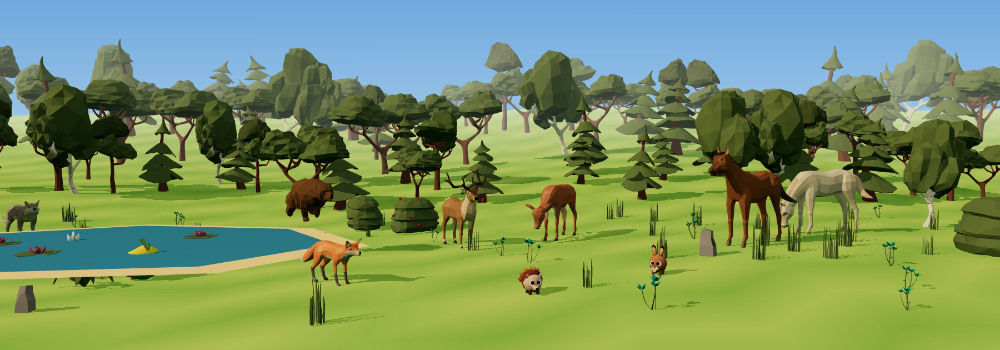

# 🦌 Le Parc de Clairbois

**A cozy wildlife park in the heart of a growing village — in low-poly 3D, right in your browser.**

Tip: <kbd>Ctrl</kbd> + click (<kbd>⌘</kbd> + click on Mac) to open the game in a new tab

No download, no account, works on desktop and mobile. 
*The game is in French 🇫🇷*

---

## The game

Clairbois is a small village at the edge of the forest. You start with a single paddock and a handful of farm animals; over the weeks you grow it into a real European wildlife park, and the village grows with you.

It's a **slow, cozy management game** made to be played a little every day: check on your animals, make a few decisions, come back tomorrow. Time keeps flowing while you're away (up to 30 days are replayed when you return), so a well-run park takes care of itself for a while.

## Features

- 🐾 **30 species** from farms and European forests: sheep, donkeys, foxes, deer, wolves, beavers, otters, lynx, brown bears, eagles, bison…
- 🏘️ **A village that levels up** across 6 stages, unlocking new zones, buildings and species, while your dirt paths turn into cobblestones and lit roads
- 🧑‍🌾 **Staff to hire and assign**: keepers, cleaners, vets, farmers and entertainers, each with a wage to pay
- 🩺 **Animal health**: diseases (some contagious) treated at the veterinary center as it gets upgraded
- 🌾 **A working farm** and vegetable garden that feed the pantry
- 🛤️ **Build your own paths**: visitors only see the paddocks linked to the entrance
- 🎟️ **Visitors and economy**: set the ticket price, place benches, fountains and food stands, keep the park clean and visitors happy
- 📜 **Missions** that guide you from your first paddock to a full park
- 🏆 **40 trophies** to collect, with medals and golden pieces displayed in the park's museum
- 🌗 **Day and night cycle** with its own music and ambient sounds
- 📰 **The Clairbois Gazette** sums up what happened while you were away
- 💾 **Saved automatically** in your browser

## Play

👉 **[romsantic.github.io/parc-de-clairbois](https://romsantic.github.io/parc-de-clairbois/)**

Your park is stored in your browser, so keep playing on the same device and browser to find it again.

## Roadmap

| Version | Theme | Status |
|---|---|---|
| V1 | The first paddocks: economy, village, missions | ✅ Released |
| V2 | *The village wakes up*: staff, diseases, farm, paths, comfort, trophies | ✅ Released |
| V3 | *The great discoveries*: expeditions and exotic animals | 🚧 In progress |
| V4 | Laboratory and rare variants | 🔭 Planned |
| V5 | Seasons and weather | 🔭 Planned |
| V6 | Take a stroll through your own park | 🔭 Planned |

## Built with

Made with [TypeScript](https://www.typescriptlang.org/) and [Three.js](https://threejs.org/), tested with 1,600+ automated tests, and published automatically on GitHub Pages.

## How it's made

Le Parc de Clairbois is designed by **Romain** and built with [Claude Code](https://claude.com/claude-code), one small step at a time: a written design for each version, tests first, an independent review and a play test before every release.

## Credits

3D models and sounds come from generous creators, mostly in the public domain (CC0): **Quaternius**, **Gobkit**, **Kenney**, **BigSoundBank** and the **OpenGameArt** community, among others.

A few models require attribution:

- *Running Brown Bear* by Google Data Arts Team (CC BY 3.0)
- *Bobcat* by Poly by Google (CC BY 3.0)
- *Bizon* by madtrollstudio (CC BY 3.0)
- *Moose* by Jérémie Louvetz (CC BY-NC 4.0)

Full list with sources and licenses: [CREDITS.md](CREDITS.md). Credits are also shown in-game (Options → Credits).
